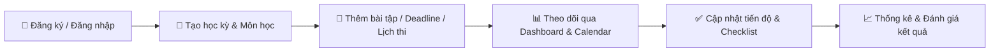

# 🎓 UniPlan — Quản Lý Học Tập & Deadline Dành Cho Sinh Viên

<div align="center">

[](https://react.dev/)
[](https://vitejs.dev/)
[](https://developer.mozilla.org/)
[](LICENSE)

**UniPlan** là giải pháp web hiện đại giúp sinh viên tổ chức kỳ học thông minh, quản lý môn học, theo dõi bài tập, lịch thi và nhận cảnh báo deadline kịp thời — tối ưu hóa thời gian và nâng cao hiệu suất học tập.

[Xem Demo](#-hướng-dẫn-cài-đặt--chạy-dự-án) • [Tính Năng](#-các-chức-năng-cốt-lõi) • [Thuật Toán Ưu Tiên](#-tính-năng-nổi-bật--tạo-điểm-nhấn) • [Công Nghệ](#-công-nghệ-sử-dụng)

</div>

---

## 📖 1. Giới Thiệu Sản Phẩm

Trong mỗi học kỳ, sinh viên thường xuyên phải đối mặt với hàng chục bài tập, thuyết trình, bài kiểm tra và lịch thi dồn dập từ nhiều môn học khác nhau. **UniPlan** ra đời nhằm giải quyết vấn đề phân bổ thời gian và giảm thiểu rủi ro quên deadline.

### 🔄 Luồng sử dụng chính:


1. **Sinh viên đăng ký / đăng nhập** tài khoản cá nhân.
2. **Khởi tạo học kỳ** và danh sách các môn đang học cùng mã môn, màu đại diện.
3. **Thêm bài tập, lịch thi hoặc sự kiện** với mức ưu tiên và thời hạn cụ thể.
4. **Theo dõi trực quan** trên lịch (tháng, tuần, danh sách) và Dashboard tổng quan.
5. **Cập nhật trạng thái hoàn thành** và chia nhỏ đầu việc qua checklist.
6. **Nhận cảnh báo thông minh** về deadline gần nhất và xem thống kê tiến độ học tập.

---

## ✨ 2. Các Chức Năng Cốt Lõi

### A. 🔐 Đăng ký, Đăng nhập & Tài khoản
- Đăng ký tài khoản nhanh chóng với Họ tên, Email, Mật khẩu.
- Đăng nhập/Đăng xuất bảo mật.
- Xem và chỉnh sửa thông tin hồ sơ cá nhân, đổi mật khẩu.
- Bảo mật dữ liệu: Mỗi sinh viên chỉ có quyền truy cập và quản lý dữ liệu học tập của chính mình.

### B. 📅 Quản lý Học Kỳ
- Tạo học kỳ linh hoạt (ví dụ: *“Học kỳ 1 — 2026”*).
- Thiết lập mốc thời gian bắt đầu và kết thúc học kỳ.
- Thiết lập học kỳ hiện tại (Active Semester).
- Chỉnh sửa hoặc lưu trữ học kỳ cũ để tra cứu lại khi cần.
- Tổng hợp số môn học và deadline trong từng học kỳ.

### C. 📚 Quản lý Môn Học
Mỗi môn học được định danh với đầy đủ thông tin:
- **Tên & Mã môn học**
- **Giảng viên phụ trách**
- **Phòng học / Đường dẫn lớp trực tuyến (Google Meet, Zoom, MS Teams)**
- **Màu sắc đại diện** (giúp nhận diện môn học trực quan trên lịch)
- **Lịch học cố định trong tuần & Ghi chú**
- Thao tác: Thêm, sửa, xóa, tìm kiếm môn học nhanh chóng.

### D. ⏰ Quản lý Deadline & Bài Tập
Hệ thống quản lý deadline chuyên sâu với các thuộc tính chi tiết:

| Thuộc tính | Mô tả | Chi tiết hỗ trợ |
| :--- | :--- | :--- |
| **Tiêu đề** | Tên bài tập / công việc | Rõ ràng, kiểm tra không rỗng |
| **Môn học** | Môn học tương ứng | Liên kết theo bảng môn học |
| **Phân loại** | Loại công việc | `Bài tập`, `Kiểm tra`, `Thi`, `Thuyết trình` |
| **Hạn chót** | Ngày & giờ hết hạn | Cảnh báo khi sắp đến hạn |
| **Mức ưu tiên**| Độ quan trọng | `Thấp` 🟢, `Trung bình` 🟡, `Cao` 🔴 |
| **Trạng thái** | Tình trạng thực hiện | `Chưa làm`, `Đang làm`, `Hoàn thành`, `Quá hạn` |
| **Tiến độ** | Phần trăm hoàn thành | Slider điều chỉnh từ `0%` – `100%` |
| **Dự kiến** | Thời gian ước lượng | Số giờ cần để hoàn thành |
| **Mô tả & Tài liệu**| Ghi chú chi tiết | Đính kèm link tài liệu tham khảo |

**Các thao tác hỗ trợ:**
- Thêm, sửa, xem chi tiết và xóa deadline (có hộp thoại xác nhận).
- Đánh dấu hoàn thành nhanh với 1 cú click.
- Nhân bản (Duplicate) deadline lặp lại.
- Tự động kiểm tra tính hợp lệ của dữ liệu đầu vào.

### E. 🗓️ Lịch Học Tập Đa Năng
Hỗ trợ 3 góc nhìn linh hoạt phù hợp với mọi thiết bị:
- **Lịch tháng (Month View):** Toàn cảnh lịch nộp bài và các sự kiện trong cả tháng.
- **Lịch tuần (Week View):** Chi tiết thời khóa biểu học tập, lịch kiểm tra theo từng ngày.
- **Dạng danh sách (List View):** Tối ưu cho thiết bị di động, dễ dàng cuộn và tra cứu nhanh.
- Sự kiện được gắn màu đồng bộ với môn học; bấm vào sự kiện để xem chi tiết hoặc chỉnh sửa ngay.

### F. 📊 Dashboard Tổng Quan
Trung tâm điều khiển ngay sau khi đăng nhập:
- Lời chào cá nhân hóa theo thời gian trong ngày.
- **Thẻ tóm tắt nhanh (KPI Cards):** Deadline hôm nay, Deadline 7 ngày tới, Đã hoàn thành, Quá hạn.
- Danh sách **Top 5 deadline gấp nhất** cần ưu tiên xử lý.
- Thanh tiến độ học kỳ tổng quan.
- Biểu đồ phân bổ deadline theo từng môn học và biểu đồ tỷ lệ hoàn thành.

### G. 🔍 Tìm Kiếm, Lọc & Sắp Xếp Nâng Cao
- **Tìm kiếm tức thì:** Tìm theo từ khóa trong tiêu đề deadline, tên môn học.
- **Bộ lọc đa tiêu chí:** Lọc theo Môn học, Loại bài tập, Trạng thái, Mức ưu tiên, Khoảng ngày.
- **Sắp xếp linh hoạt:** Theo hạn chót gần nhất, mức độ ưu tiên hoặc phần trăm tiến độ.
- **Bộ lọc nhanh (Quick Filters):**
  - ⚡ *Hôm nay*
  - ⏳ *7 ngày tới*
  - 📌 *Chưa hoàn thành*
  - 🚨 *Đã quá hạn*
  - 🔥 *Ưu tiên cao*

### H. 🔔 Hệ Thống Nhắc Việc & Cảnh Báo
- Huy hiệu (Badge) đếm số lượng công việc đang chờ xử lý.
- Mã màu trực quan theo mức độ khẩn cấp:
  - 🟢 **Xanh lá:** Còn nhiều thời gian (> 3 ngày).
  - 🟡 **Vàng:** Sắp đến hạn (còn dưới 3 ngày).
  - 🔴 **Đỏ:** Báo động khẩn cấp (còn dưới 24 giờ).
  - ⚫ **Xám / Đỏ đậm:** Đã quá hạn nộp bài.
- Tùy chọn nhắc nhở trước 1 ngày, 3 ngày hoặc 7 ngày.

---

## 💡 3. Tính Năng Nổi Bật & Tạo Điểm Nhấn

### 🧠 1. Điểm Ưu Tiên Thông Minh (Smart Priority Score)
Không cần AI phức tạp, UniPlan áp dụng công thức trọng số tối ưu giúp hệ thống tự động trả lời câu hỏi: **"Bây giờ tôi nên làm gì trước?"**

$$\text{Điểm Ưu Tiên} = (\text{Mức Ưu Tiên} \times 3) + (\text{Độ Khẩn Cấp} \times 2) + \frac{100 - \text{Tiến Độ}}{20}$$

- Tự động gợi ý **Top 3 công việc quan trọng & khẩn cấp nhất** cần giải quyết ngay.

### 📝 2. Checklist Cho Từng Deadline
Cho phép chia nhỏ một deadline lớn (như Đồ án / Bài tập lớn) thành các nhiệm vụ con:
- [x] Chọn đề tài & lập dàn ý
- [x] Thu thập tài liệu nghiên cứu
- [/] Thiết kế giao diện (UI/UX)
- [ ] Lập trình chức năng
- [ ] Kiểm thử & sửa lỗi
- [ ] Hoàn thiện slide báo cáo
> 💡 *Tiến độ tổng thể của deadline có thể tự động đồng bộ theo số mục checklist đã hoàn thành.*

### 📈 3. Thống Kê & Phân Tích Thói Quen Học Tập
- Thống kê môn học có khối lượng bài tập lớn nhất trong kỳ.
- Tỷ lệ hoàn thành đúng hạn vs hoàn thành trễ hạn.
- Biểu đồ năng suất theo từng tuần học.
- Theo dõi **Chuỗi ngày hoàn thành công việc liên tiếp (Streak)** tạo động lực học tập.

---

## 🛠️ 4. Công Nghệ Sử Dụng

- **Frontend Core:** [React 18](https://react.dev/) (Functional Components, Hooks)
- **Build Tool:** [Vite](https://vitejs.dev/) (Tốc độ khởi động siêu nhanh, HMR tức thì)
- **Styling:** CSS3 hiện đại, CSS Variables, Flexbox, CSS Grid
- **Lưu trữ dữ liệu:** LocalStorage (Demo độc lập, sẵn sàng mở rộng REST API / Firebase)
- **Giao diện:** Hỗ trợ đầy đủ **Dark Mode** & **Light Mode**, thiết kế Responsive trên Desktop, Tablet, Mobile.

---

## 🚀 5. Hướng Dẫn Cài Đặt & Chạy Dự Án

### Yêu cầu môi trường:
- [Node.js](https://nodejs.org/) phiên bản 16.0 trở lên
- Trình quản lý gói `npm` (hoặc `pnpm` / `yarn`)

### Các bước cài đặt:

1. **Clone repository về máy:**
   ```bash
   git clone https://github.com/minh160905/UniPlan.git
   cd UniPlan
   ```

2. **Cài đặt các gói thư viện phụ thuộc:**
   ```bash
   npm install
   ```

3. **Chạy máy chủ phát triển (Development Mode):**
   ```bash
   npm run dev
   ```
   Sau đó mở trình duyệt và truy cập: **`http://localhost:5173`** (hoặc `http://127.0.0.1:5173`)

4. **Đóng gói dự án (Production Build):**
   ```bash
   npm run build
   ```

5. **Xem thử bản build (Preview Build):**
   ```bash
   npm run preview
   ```

---

## 🗺️ 6. Lộ Trình Phát Triển (Roadmap)

- [ ] Tích hợp thông báo qua Email & Web Push Notification.
- [ ] Đồng bộ 2 chiều với **Google Calendar** và **Outlook Calendar**.
- [ ] Bổ sung Backend (Node.js/Express hoặc Firebase) để lưu trữ dữ liệu đám mây đa thiết bị.
- [ ] Chức năng làm việc nhóm: Chia sẻ bài tập lớn và phân công thành viên.

---

## 📄 Giấy Phép & Tác Giả

- Dự án được phát triển bởi **[minh160905](https://github.com/minh160905)**.
- Phát hành theo giấy phép **MIT License**. Mọi đóng góp (Pull Request, Issue) đều được hoan nghênh!
